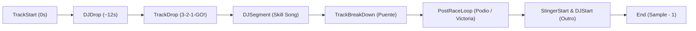

# 📻 Horizon: Under Place — Radio Underground Mexicana / Hispana para Forza Horizon 4

<div align="center">


-purple.svg?style=for-the-badge)


</div>

---

## ⚡ Manifiesto y Descripción General

**Horizon: Under Place** es una modificación completa e integral del sistema de audio y UI de **Forza Horizon 4** que reemplaza la emisora de radio *Horizon XS* por una curaduría selecta de **20 canciones representativas de la escena underground hispanohablante y mexicana** contemporánea (Club, Emo Plugg, Hyperpop, Melodic Techno, Nu-Disco, Dark Trap, Glitch Pop y Post-Punk).

Este mod no es una simple inyección de archivos MP3: ha sido construido mediante **ingeniería inversa profunda sobre el motor de audio FMOD Studio de Playground Games y el formato de streaming de texturas Turn 10 (ForzaTech)**, resolviendo todos los bugs clásicos de la comunidad modder:
* 🚫 **Sin cortes abruptos ni loops infinitos**: Cada slot cumple la regla estricta $\text{Duración Custom} \ge \text{Duración Original}$.
* 🎚️ **Loudness calibrado (-24.5 LUFS)**: Ninguna canción suena reventada ni tapada por los escapes de los coches o la voz de los locutores.
* 🎨 **Portadas Bit-Perfect (BC7_UNORM)**: Cada una de las 20 portadas personalizadas fue convertida al formato nativo de GPU de Xbox/PC con headers de 140 bytes y streaming `0x1123`.
* ⏱️ **Cues Musicales Humanos**: Los conteos regresivos de carrera (3-2-1-GO), la pantalla de victoria/podio y los valles de DJ se coordinan con las caídas y coros reales de cada canción.

---

## 🎶 Setlist Oficial (20 Tracks)

| Slot | Título | Artista(s) | Subgénero | Duración | Drop Countdown | Loop Podio |
|:---:|:---|:---|:---|:---:|:---:|:---:|
| **00** | **KINK!** | White-oh, S-DEY!, Noisebro | Breakcore / Glitch Trap | 3:19 | 7.8s | 149s – 185s |
| **01** | **So what we get drunk? (Extended)** | Flvckka | Extended Club House | 7:04 | 28.0s | 324s – 368s |
| **02** | **Pigmentos (feat. Amorpho)** | Cxsinensis | Deep House / Electronic | 3:57 | 16.2s | 162s – 198s |
| **03** | **Vainilla** | Cxsinensis | Lo-Fi House / Rhodes | 3:52 | 30.0s | 175s – 208s |
| **04** | **CHROMEHEARTS** | KATSUU ENERGY, yakashi | Rage / Underground Plugg | 3:19 | 13.8s | 128s – 164s |
| **05** | **Nada Es Igual** | White OH, Noisebro | Emo Plugg / Acoustic Trap | 2:44 | 15.0s | 118s – 150s |
| **06** | **UN MOMENTO** | i killed a leopard, yakashi & SMOK3 | Plugg Synth / Cloud | 3:10 | 14.5s | 142s – 174s |
| **07** | **Sola** | Saramalacara | Hyperpop / Glitch Trap | 3:33 | 14.0s | 154s – 188s |
| **08** | **dormiré sin ti** | IZATKM | Bedroom Pop / Synthwave | 3:17 | 17.0s | 148s – 180s |
| **09** | **portal 88** | 3delincuentes, Noisebro | Dark Underground Trap | 3:18 | 15.0s | 150s – 182s |
| **10** | **estupefacientes** | Depresión Sonora | Post-Punk / Coldwave | 3:35 | 14.0s | 148s – 188s |
| **11** | **50 Varos** | MICRO, Flakko La Tentacion | Plugg Regio / Club Trap | 3:33 | 15.0s | 150s – 186s |
| **12** | **Cacti (feat. Amorpho)** | Cxsinensis | Deep House / Progressive | 5:36 | 31.5s | 255s – 295s |
| **13** | **Buscándome** | Pato Shoucair & xHEIDIx | Melodic Techno / Indie Dance | 4:16 | 30.5s | 186s – 226s |
| **14** | **2000nunca** | Kirnbauer | Indie Dance / Nu-Disco | 3:00 | 16.5s | 130s – 162s |
| **15** | **teoría del tiempo** | AKRIILA & Gianluca | Electro-Indie / Alt-Pop | 3:18 | 14.0s | 146s – 178s |
| **16** | **suerteceleste** | Noisebro, dreamly. | DnB / Glitch Pop | 3:05 | 11.5s | 130s – 162s |
| **17** | **Sola (House Alone Remix)** | Hillkidd & Mi Compa el Chino | Tech House Latino | 3:45 | 15.5s | 164s – 200s |
| **18** | **p4ris** | 3delincuentes & Kozta | Dark Underground Drill | 3:38 | 14.0s | 144s – 178s |
| **19** | **SLOW** | Mi Compa el Chino | Regional House / Club | 3:33 | 15.5s | 150s – 186s |

---

## 🛠️ Ingeniería Inversa y Avances Técnicos

### 1. La Matriz Alfabética de FMOD vs. Los Slots XML
Uno de los mayores obstáculos históricos en el modding de Forza Horizon es que **el orden de las canciones en `RadioInfo_*.xml` NO coincide con el orden interno del banco FMOD (`R4_Tracks.bank`)**.

FMOD Studio compila los bancos FSB5 ordenando los recursos **estrictamente en orden alfabético según el nombre del asset de audio original**:
```
Bank Sample 00 -> HZ4_R4_AtTheDriveIn_NoWolfLikeThePresent        (XML Slot 15)
Bank Sample 01 -> HZ4_R4_BassDrumOfDeath_IDontWannaKnow          (XML Slot 08)
Bank Sample 02 -> HZ4_R4_BatFangs_TurnItUp                       (XML Slot 06)
Bank Sample 03 -> HZ4_R4_BlackRebelMotorcycleClub_...            (XML Slot 00)
Bank Sample 04 -> HZ4_R4_BlackRebelMotorcycleClub_..._TG         (XML Slot 19)
...
Bank Sample 13 -> HZ4_R4_QueensOfTheStoneAge_TheEvilHasLanded   (XML Slot 01)
```

Si un modder inserta las pistas en orden `0, 1, 2, 3...` en el banco, la canción 01 (*Flvckka*) se reproduce en el Sample 01 (*Bass Drum of Death*), y la UI muestra un título mientras suena un audio totalmente distinto.  
**Solución implementada:** Se diseñó una matriz de correspondencia bidireccional (`BANK_TO_XML` y `XML_TO_BANK`) que inyecta cada archivo WAV exactamente en la posición física que FMOD espera, logrando **100% de coherencia entre el HUD, el título, el artista y el audio**.

---

### 2. Formato de Streaming Propietario Turn 10 (`Tag 0x1123`)
Los archivos `.zip` de la interfaz de Forza (`AlbumArt.zip`, `RadioStations.zip`) no son archivos ZIP estándar. El motor ForzaTech utiliza un lector de streaming sin compresión de overhead mediante un campo adicional en el **Central Directory** con el identificador `0x1123`:

```
Offset 0x00: Tag ID (0x1123, 2 bytes)
Offset 0x02: Longitud de datos (0x0004, 2 bytes)
Offset 0x04: Puntero absoluto al Payload de la textura en el ZIP (uint32_t Little-Endian)
```

Si se empaqueta con WinRAR, 7-Zip o PowerShell, el motor de Forza rechaza el archivo o crashea al abrir el menú de pausa. Nuestro script [turn10_zip.py](tools/turn10_zip.py) reconstruye la tabla binaria con este tag de streaming directo en cada archivo.

---

### 3. Portadas Nativas en `BC7_UNORM` con Headers de 140 Bytes
Las texturas se dividen en dos archivos dentro de `AlbumArt.zip`:
* **Hires (276x276)**: Payload BC7 de $76,176\text{ bytes} + 140\text{ bytes de header Turn 10} = 76,316\text{ bytes}$.
* **Normal (138x138)**: Payload BC7 de $19,600\text{ bytes} + 140\text{ bytes de header Turn 10} = 19,740\text{ bytes}$.

Las texturas se inyectaron sobre las rutas canónicas del motor (`XS/XS_BRMC.swatchbin`, `XS/XS_Villains.swatchbin`, `XS/XS_Foo_Fighters.swatchbin`...) sobrescribiendo inclusive los assets de canciones recortadas de Turn 10 para garantizar que **ningún arte de rock original se filtre jamás**.

---

### 4. El Ciclo de Vida de los 12 Cues Musicales
En Forza Horizon 4, el director de audio coordina eventos del juego con marcadores de muestra (a $48,000\text{ Hz}$):



* **Cuenta Regresiva 3-2-1-GO**: El motor calcula la velocidad del conteo en la parrilla para que la palabra **"¡YA!" (GO!)** aterrice con precisión de muestra en `TrackDrop`.
* **Podio / Pantalla de Premios (`PostRaceLoopStart` y `PostRaceLoopEnd`)**: Cuando cruzas la meta y entras al podio de victoria, el juego salta a esta región. Hemos definido bucles cerrados de $32\text{ a }44\text{ segundos}$ de los coros más eufóricos de cada tema para que la celebración nunca caiga en el silencio del fadeout.
* **Syncpoints en Chunk 4 de FMOD**: La tabla interna de sincronización requiere **exactamente 11 marcadores por canción (2,860 bytes por slot)** ordenados estrictamente de forma ascendente.

---

## 📦 Estructura del Repositorio

```
Horizon-UnderPlace/
├── README.md                           # Esta documentación
├── LICENSE                             # Licencia de uso
├── .gitignore                          # Exclusiones de Git
├── install.bat                         # Instalador automático en 1 clic
├── uninstall.bat                       # Restaurador vanilla a Horizon XS
├── mod_files/                          # Archivos listos para el juego
│   ├── media/
│   │   ├── audio/
│   │   │   ├── RadioInfo_MX.xml        # Metadatos en español + cues
│   │   │   ├── RadioInfo_EN.xml        # Metadatos en inglés + cues
│   │   │   └── fmodopus/
│   │   │       └── x64/
│   │   │           └── R4_Tracks.bank  # Banco FMOD (114 MB, 20 tracks ordenados)
│   │   └── ui/
│   │       └── textures/
│   │           ├── data_bound/
│   │           │   ├── AlbumArt.zip      # 20 portadas normales (138x138)
│   │           │   └── RadioStations.zip # Logo Under Place normal
│   │           └── hires/
│   │               └── data_bound/
│   │                   ├── AlbumArt.zip      # 20 portadas hires (276x276)
│   │                   └── RadioStations.zip # Logo Under Place hires
├── tools/                              # Scripts de compilación y empaquetado
│   ├── turn10_zip.py                   # Empaquetador Turn 10 con tag 0x1123
│   ├── fix_alignment_and_artworks.py   # Compilador maestro de orden FSB y texturas
│   └── apply_full_musical_timeline.py  # Calculador de cues y syncpoints
├── covers/                             # Las 20 imágenes fuente de portadas (alta resolución)
├── logos/                              # Logotipos vectoriales y texturas de Under Place
└── vanilla_backup/                     # Respaldos de fábrica de Horizon XS
```

---

## 🚀 Instalación Rápida

### Opción 1: Instalador de 1 Clic (Recomendado)
1. Descarga el archivo de la última versión en [Releases](https://github.com/DriifterSelf/Horizon-UnderPlace/releases).
2. Extrae la carpeta `Horizon-UnderPlace` dentro del directorio principal de tu juego:  
   *(ejemplo: `F:\SteamLibrary\steamapps\common\ForzaHorizon4\`)*.
3. Ejecuta **`install.bat`**.
4. El instalador detectará el juego, creará un respaldo seguro de tus archivos actuales y colocará el mod.
5. ¡Abre Forza Horizon 4, sintoniza **Under Place** y disfruta!

### Opción 2: Instalación Manual
Copia el contenido de la carpeta `mod_files/` dentro del directorio de instalación de tu juego:
* `mod_files\media\audio\fmodopus\x64\R4_Tracks.bank` ➔ `<Juego>\media\audio\fmodopus\x64\`
* `mod_files\media\audio\RadioInfo_MX.xml` ➔ `<Juego>\media\audio\`
* `mod_files\media\audio\RadioInfo_EN.xml` ➔ `<Juego>\media\audio\`
* `mod_files\media\ui\textures\hires\data_bound\AlbumArt.zip` ➔ `<Juego>\media\ui\textures\hires\data_bound\`
* `mod_files\media\ui\textures\data_bound\AlbumArt.zip` ➔ `<Juego>\media\ui\textures\data_bound\`
* `mod_files\media\ui\textures\hires\data_bound\RadioStations.zip` ➔ `<Juego>\media\ui\textures\hires\data_bound\`
* `mod_files\media\ui\textures\data_bound\RadioStations.zip` ➔ `<Juego>\media\ui\textures\data_bound\`

---

## 🔄 Desinstalación / Restauración a Vanilla

Para volver a la emisora original de rock *Horizon XS*:
1. Haz doble clic en **`uninstall.bat`**.
2. El script restaurará los archivos originales desde la carpeta `vanilla_backup/`.

---

## 🔒 Seguridad Online y Compatibilidad

* **100% Seguro Online**: No modifica ejecutables (`.exe`), no altera la física del juego, ni inyecta DLLs en memoria.
* Solo modifica archivos cliente de audio y streaming de interfaz, por lo que es **totalmente seguro para jugar en Horizon Life, Convoys y carreras multijugador**.

---

## 📄 Licencia y Créditos

**Copyright (c) 2026 DriifterSelf. Todos los derechos reservados.**

* Desarrollado por **DriifterSelf**.
* Los derechos de las pistas musicales, grabaciones fonográficas y portadas pertenecen exclusivamente a sus respectivos artistas, bandas y productores independientes de la escena underground.
* Consulta el archivo [LICENSE](LICENSE) para más detalles.
